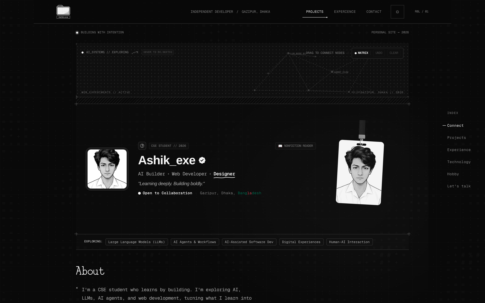
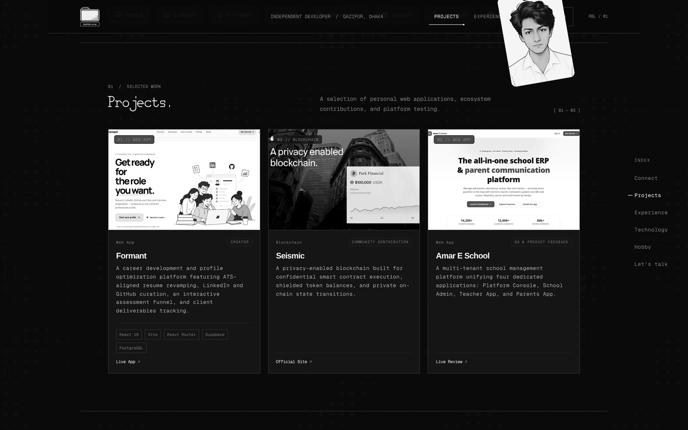
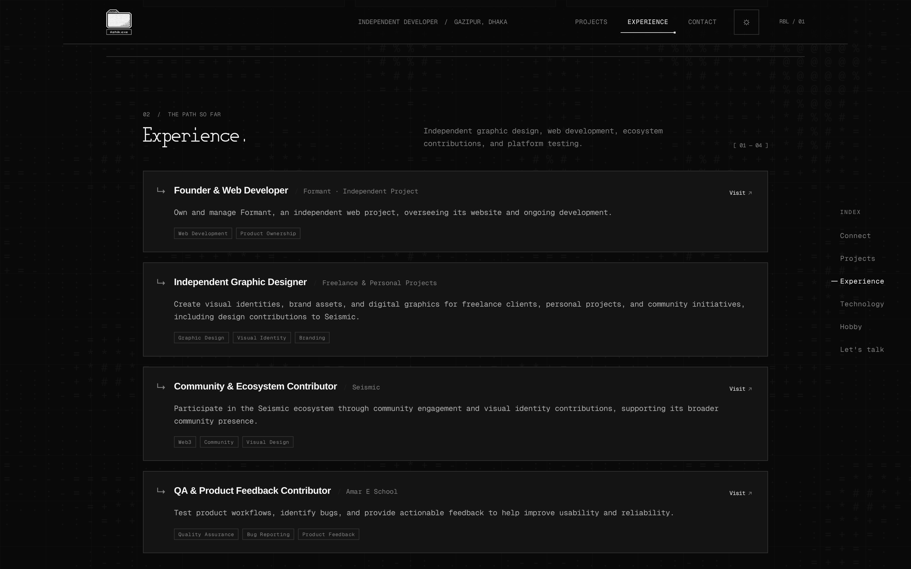
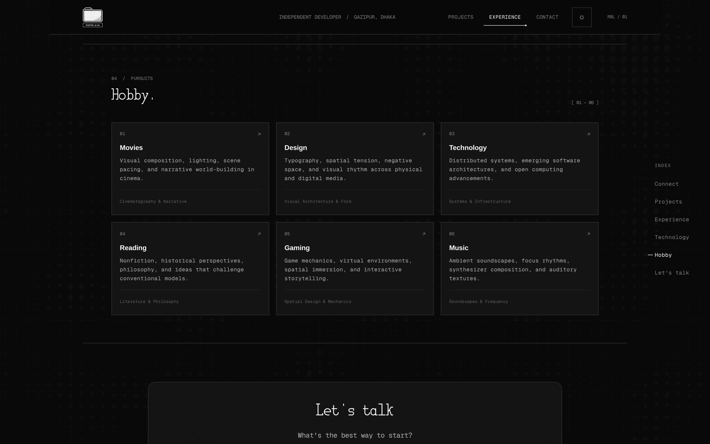

# Ashik.exe — Personal Portfolio

> A design-conscious, interactive personal portfolio engineered with modern web technologies, 3D physics, and a minimalist editorial aesthetic.

---

## Overview

[ashik-exe.vercel.app](https://ashik-exe.vercel.app/) is the personal portfolio of **Ashik**, showcasing selected engineering projects, creative design contributions, and technical pursuits. Designed with an intentional monochrome palette, disciplined typography, and tactile interactions, the site combines visual restraint with modern web graphics.

---

## Public Showcase Notice

> [!NOTE]
> This repository is a **public showcase and architectural documentation** of the Ashik.exe portfolio. The underlying production source code, proprietary component implementations, and deployment configurations are maintained privately.

---

## Key Features

- **Interactive 3D Lanyard ID Badge**: A custom Three.js WebGL simulation featuring real-time rope physics, card inertia, mouse drag interactions, and fluid scroll tracking.
- **Interactive Dot Matrix Canvas**: An embedded canvas playground allowing visitors to draw strokes, generate dynamic cursor trails, and undo or clear interactions.
- **Ambient ASCII Canvas Background**: A subtle background canvas delivering an organic generative texture that responds to user presence.
- **Editorial Monochrome Aesthetic**: High-contrast typography, strict grid composition, and an adaptive light/dark theme switch.
- **Fluid Animation System**: Hardware-accelerated entrance reveals, hover states, and smooth section transitions powered by Motion.
- **Responsive Layout**: Designed for seamless typography scaling, touch navigation, and visual hierarchy across desktop, tablet, and mobile displays.

---

## Website Structure

The live portfolio is structured into eight focused sections:

| Section | Focus & Description |
| :--- | :--- |
| **Hero & Profile** | Dynamic banner with interactive Dot Matrix playground, profile card, 3D hanging lanyard badge, and status indicators. |
| **About** | Personal introduction emphasizing a build-to-learn philosophy, exploring AI, LLMs, AI agents, and web applications. |
| **Connect** | Direct links to GitHub, LinkedIn, X (Twitter), Discord, and email communication channels. |
| **01 / Selected Work** | Highlighted engineering, design, and product contributions with direct external links. |
| **02 / The Path So Far** | Chronological timeline of independent projects, freelance design, and ecosystem roles. |
| **03 / Tech Stack** | Verified technology foundation powering the web experience. |
| **04 / Pursuits** | Six creative disciplines outside software engineering. |
| **Let's Talk** | Direct message portal and inquiries interface. |

---

## Featured Projects

### 1. Formant
- **Role**: Creator & Web Developer (`01 // WEB APP`)
- **Live URL**: [https://formant.cv/](https://formant.cv/)
- **Description**: A career development and profile optimization platform featuring ATS-aligned resume revamping, LinkedIn and GitHub curation, an interactive assessment funnel, and client deliverables tracking.
- **Focus Areas**: Web Development · Product Ownership

### 2. Seismic
- **Role**: Community Contribution (`02 // BLOCKCHAIN`)
- **Live URL**: [https://www.seismic.systems/](https://www.seismic.systems/)
- **Description**: A privacy-enabled blockchain built for confidential smart contract execution, shielded token balances, and private on-chain state transitions.
- **Focus Areas**: Web3 · Community · Visual Identity

### 3. Amar E School
- **Role**: QA & Product Feedback (`03 // WEB APP`)
- **Live URL**: [Live Preview](https://smart-school-erp-review--amar-e-school.asia-southeast1.hosted.app/welcome)
- **Description**: A multi-tenant school management platform unifying four dedicated applications: Platform Console, School Admin, Teacher App, and Parents App.
- **Focus Areas**: Quality Assurance · Bug Reporting · Product Feedback

---

## Experience & Background

The **02 / The Path So Far** section highlights hands-on experience spanning product creation, design systems, and ecosystem collaboration:

1. **Founder & Web Developer** — *Formant · Independent Project*  
   Owns and manages Formant, an independent web platform, directing website architecture and ongoing product development.  
   `Web Development` · `Product Ownership` · [Visit Formant](https://formant.cv/)

2. **Independent Graphic Designer** — *Freelance & Personal Projects*  
   Creates visual identities, brand assets, and digital graphics for freelance clients, personal initiatives, and community projects, including visual contributions to Seismic.  
   `Graphic Design` · `Visual Identity` · `Branding`

3. **Community & Ecosystem Contributor** — *Seismic*  
   Participates in the Seismic ecosystem through community engagement and visual identity contributions, supporting its broader community presence.  
   `Web3` · `Community` · `Visual Design` · [Visit Seismic](https://www.seismic.systems/)

4. **QA & Product Feedback Contributor** — *Amar E School*  
   Tests core user workflows, diagnoses interface anomalies, and provides actionable feedback to refine overall platform reliability and usability.  
   `Quality Assurance` · `Bug Reporting` · `Product Feedback` · [Visit Amar E School](https://smart-school-erp-review--amar-e-school.asia-southeast1.hosted.app/welcome)

---

## Creative Pursuits

The **04 / Pursuits** section documents key creative and intellectual interests outside day-to-day coding:

- **01 — Movies**: Visual composition, lighting, scene pacing, and narrative world-building in cinema (*Cinematography & Narrative*).
- **02 — Design**: Typography, spatial tension, negative space, and visual rhythm across physical and digital media (*Visual Architecture & Form*).
- **03 — Technology**: Distributed systems, emerging software architectures, and open computing advancements (*Systems & Infrastructure*).
- **04 — Reading**: Nonfiction, historical perspectives, philosophy, and ideas that challenge conventional models (*Philosophy & Knowledge*).
- **05 — Gaming**: Game mechanics, virtual environments, spatial immersion, and interactive storytelling (*Virtual Worlds & Mechanics*).
- **06 — Music**: Ambient soundscapes, focus rhythms, synthesizer composition, and auditory textures (*Soundscapes & Synthesis*).

---

## Verified Technology Stack

Technologies and libraries verified through client bundle analysis and production asset verification:

| Category | Technology | Usage & Implementation |
| :--- | :--- | :--- |
| **Framework** | [Next.js](https://nextjs.org/) | Modern App Router architecture, server-rendered components, and route optimization |
| **UI Library** | [React 19](https://react.dev/) | Component architecture, state management, and modern React hooks |
| **Language** | [TypeScript](https://www.typescriptlang.org/) | Type safety across client components and data structures |
| **3D & Graphics** | [Three.js](https://threejs.org/) & WebGL | Real-time 3D lanyard ID card simulation, rope physics, and custom GLSL shaders |
| **Motion** | [Motion](https://motion.dev/) | Smooth entrance animations, hover physics, and layout transitions |
| **Styling** | [Tailwind CSS](https://tailwindcss.com/) | Utility-first responsive styling and typography scale |
| **Canvas** | HTML5 2D Canvas | Interactive Dot Matrix playground and generative ambient background |
| **Deployment** | [Vercel](https://vercel.com/) | Edge hosting, global CDN, and automatic continuous deployment |

---

## Live Website

Experience the live portfolio with all interactive features enabled:  
👉 **[https://ashik-exe.vercel.app/](https://ashik-exe.vercel.app/)**

---

  [YN]. · MADE WITH CARE, KEPT DELIBERATELY SIMPLE. · © 2026 Ashik.exe

